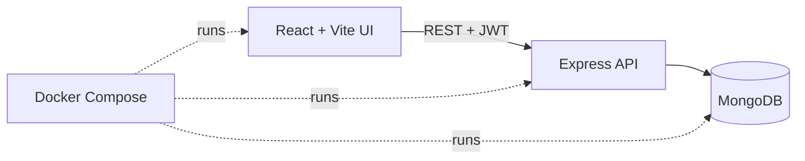

# PlantLog — Industrial Asset & Maintenance Logbook

**Technical reviewer brief:** [System evidence, reproducibility and operational limits](docs/hiring-summary.md).


> Designed workflow overview; not a live plant dashboard screenshot. The historical interface captures below predate the dashboard update that replaced hard-coded counts and the placeholder activity panel with API-backed metrics and recent logs.


**React · TypeScript · Node.js/Express · MongoDB · Docker Compose**

A full-stack industrial operations prototype that organizes asset records, maintenance activities and shift incidents into a single operator-facing workflow.


**Explore the zero-login demo:** [Public sample dashboard](/demo) (route available when hosting the frontend) · [Demo guide](docs/demo-guide.md)

**Explore:** [Portfolio project](https://senanur-cetin.vercel.app/#projects) · [Asset registry](docs/assets.png) · [Maintenance log](docs/logs.png)

## Problem and approach

In many facilities, asset lists, shift handovers and maintenance histories live in separate spreadsheets or paper registers. PlantLog demonstrates a unified web workflow for tracking equipment and operational events, with a REST API backed by MongoDB.

## Features

- **Asset registry:** central equipment list and status-oriented views.
- **Maintenance and incident records:** structured operational logs for review and handover.
- **Authentication:** JWT-backed API authentication and role-oriented application flows.
- **Operator dashboard:** overview interface for operational status and recent activity.
- **Separated services:** React/Vite frontend, Express API and MongoDB database.

## Architecture



| Component | Implementation | Location |
|---|---|---|
| Web UI | React 18, TypeScript, Vite, Zustand, Tailwind | `frontend/` |
| API | Node.js, Express, TypeScript, Mongoose | `backend/` |
| Persistence | MongoDB 6 | Compose service `mongodb` |
| Deployment demo | Docker Compose / Nginx | `docker-compose.yml` |

## Public, read-only demo

The standalone frontend route `/demo` uses fully synthetic bundled fixtures. It needs **no account, API, MongoDB, credentials or external plant connection**. Visit the route through your hosted frontend or run `cd frontend && npm ci && npm run dev`, then open `http://localhost:5173/demo`. You can inspect KPIs, browse equipment, search/filter logs and drill into per-asset history. All interactions are read-only; there is no database persistence. See [demo guide](docs/demo-guide.md).

## Getting started

### Option A — Docker Compose (local demo)

**Requirements:** Docker Engine or Docker Desktop with Compose, and available ports 8081, 5000 and loopback-only 27017.

```bash
git clone https://github.com/senanurcetin/PlantLog-MERN.git
cd PlantLog-MERN

# Generate a strong random secret before starting the stack.
# Linux/macOS (OpenSSL):
export JWT_SECRET="$(openssl rand -hex 32)"
docker compose up --build -d
```

On PowerShell, generate a random key using:

```powershell
$bytes = New-Object byte[] 32
[System.Security.Cryptography.RandomNumberGenerator]::Create().GetBytes($bytes)
$env:JWT_SECRET = [BitConverter]::ToString($bytes).Replace('-', '').ToLowerInvariant()
```

- Web application: `http://localhost:8081`
- REST API: `http://localhost:5000/api`
- MongoDB: `127.0.0.1:27017` (bound to the local machine only)

Stop the stack with `docker compose down`; add `-v` **only** if you intentionally want to delete the database volume.

### Option B — Run services locally

**Requirements:** Node.js 20+, npm, and a running local MongoDB instance.

```bash
cd backend
npm install
cp .env.example .env
# Edit .env and set MONGO_URI and a strong JWT_SECRET
npm run dev
```

Start the frontend in a separate terminal from the repository root:

```bash
cd frontend
npm install
cp .env.example .env
# VITE_API_URL defaults to http://localhost:5000/api
npm run dev
```

PowerShell users can replace `cp` with `Copy-Item`.

## Validation

```bash
cd backend && npm ci && npm test
cd ../frontend && npm ci && npm run test:demo && npm run build
```

The backend includes Node built-in policy regression tests for registration roles, write-field allowlists, log metrics and JWT secret configuration. These tests are **not** a replacement for database-backed API integration or end-to-end security tests.

## Security and limitations

- **Development configuration only:** Compose binds MongoDB to host loopback and requires `JWT_SECRET` to be set. Signing and verification reject known placeholders and keys under 32 characters. API port 5000 is still mapped to the host; use TLS and access controls before any external deployment.
- **Prototype scope:** this repository is not a production CMMS, EAM or validated regulated-industry logbook.
- **Authentication hardening:** public registration always provisions an `operator`, not an administrator or supervisor; privileged role assignment requires a trusted administrative action. Protected endpoints reject inactive accounts. Rate limiting, token storage, formal access reviews and audit retention still need further work.
- **Demo assets:** the public demo's fixture is fictional, and screenshots show project interfaces rather than live equipment integration.

## Repository map

- `backend/src/` — API, persistence and authentication
- `frontend/src/` — user interface and API client
- `docker-compose.yml` — local three-service orchestration
- `docs/` — product screenshots and examples

## License

[MIT](LICENSE)
