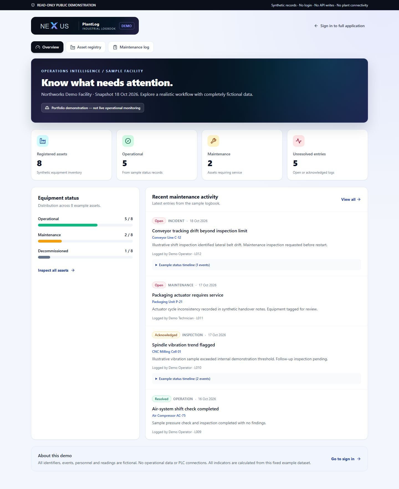
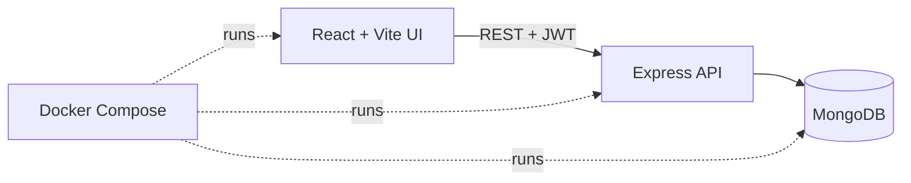

# PlantLog — Industrial Asset & Maintenance Logbook

**A NEXUS 2.0 portfolio project.** The public demo and authenticated screens use the original approved NEXUS SVG logo and the Midnight/Cyan/Blue/Lavender/Violet identity. [Brand source and implementation notes](docs/nexus-brand.md).


**Technical reviewer brief:** [System evidence, reproducibility and operational limits](docs/hiring-summary.md).


> The architecture diagram illustrates the workflow. The NEXUS screenshots below come from the **verified production-equivalent, guest-only frontend build** (19 October 2026), not an authenticated production plant dashboard. Earlier `docs/dashboard.png`, `docs/assets.png` and `docs/logs.png` remain as historical interface captures.


**React · TypeScript · Node.js/Express · MongoDB · Docker Compose**

A full-stack industrial operations prototype that organizes asset records, maintenance activities and shift incidents into a single operator-facing workflow.



**Launch the public read-only demo:** [plantlog-nexus-demo.vercel.app/demo](https://plantlog-nexus-demo.vercel.app/demo). It contains synthetic data only and requires no API, database or login. For reproduction, see the [demo guide](docs/demo-guide.md).

**Screens:** [Equipment register](docs/nexus-demo-assets.png) · [Maintenance log](docs/nexus-demo-logs.png) · [New insights](docs/nexus-demo-insights.png) · [Insights on mobile](docs/nexus-demo-insights-mobile.png) · [Scenario lab](docs/nexus-scenario-lab-desktop.png) · [Scenario lab mobile](docs/nexus-scenario-lab-mobile.png) · [Mobile demo](docs/nexus-demo-mobile.png) · [Mobile login design (local full-app mode)](docs/nexus-login-mobile.png).

### Advanced demonstration, intentionally not a product

**Scientific integrity:** Demo Insights exposes six data-quality gates on fictional records; see the [method notes](docs/demo-guide.md#scientific-data-quality-checks).

The publicly hosted `Scenario lab` is an **in-memory educational sandbox**, not a workflow for real incidents. Visitors can try one deterministic, fictional maintenance incident through `open → acknowledged → in progress → resolved`, inspect its temporary impact on Demo Insights, and reset without changing any original fixture. No persistent user state, backend writes, real plant connectivity, account creation, billing or productized service is provided by the hosted demo.

## Problem and approach

In many facilities, asset lists, shift handovers and maintenance histories live in separate spreadsheets or paper registers. PlantLog demonstrates a unified web workflow for tracking equipment and operational events, with a REST API backed by MongoDB.

## Features

- **Asset registry:** strictly validated metadata updates, central equipment list, searchable status views, supervisor/admin status updates, and spreadsheet-formula-safe CSV export of only the currently filtered equipment. New equipment status events include server timestamps and the authenticated actor; concurrent updates use revision checks. Decommissioning is terminal; new logs cannot be created for decommissioned equipment, but existing history remains accessible. Older records retain unknown status history rather than invented events. Asset creation accepts only validated equipment metadata, normalizes text and starts with `operational` status; operators cannot self-assign a privileged equipment state.
- **Maintenance and incident records:** strictly validated typed edits, structured operational logs, forward-only state transitions, server-stamped status history, immutable resolved records (amendments use new entries), and filtered CSV export with formula-safe encoding.
- **Authentication:** JWT-backed API authentication and role-oriented application flows. Session changes synchronously clear browser registry caches; late responses from older sessions and obsolete filtered requests are ignored. Registration shares the login email validator, permits only explicit profile fields, and rejects passwords exceeding bcrypt's 72-byte input limit. Asset/log listing APIs expose actor names and roles but do not include other users' email addresses.
- **Operator dashboard:** overview interface for operational status and recent activity, with responsive authenticated navigation and accessible mobile links. The open maintenance-case KPI includes unresolved incident/maintenance entries only; routine operations and inspections do not inflate this count. Failed data fetches show unavailable values rather than stale KPI counts.
- **Evidence-aware analytics:** authenticated `/analytics` view and `/api/analytics/maintenance` endpoint for report-to-resolution timing, with eligibility and exclusion counts, type-level breakdowns, equal-duration intake trends and evidence-qualified unresolved age buckets. The `/api/analytics/equipment` endpoint provides a transparent count of unresolved cases created within the chosen period by equipment, including missing-asset and undisplayed-case totals. Outside-window unresolved cases (older, undated, future-dated) are disclosed separately to prevent confusing a quiet reporting period with zero overall backlog. This is **not** MTTR or equipment uptime. See [metric definitions](docs/maintenance-metrics.md).
- **Separated services:** React/Vite frontend, Express API and MongoDB database.

## Architecture



| Component | Implementation | Location |
|---|---|---|
| Web UI | React 18, TypeScript, Vite, Zustand, Tailwind | `frontend/` |
| API | Node.js, Express, TypeScript, Mongoose | `backend/` |
| Persistence | MongoDB 6 | Compose service `mongodb` |
| Deployment demo | Docker Compose / Nginx | `docker-compose.yml` |

## Public, read-only demo

The publicly hosted static frontend runs with `VITE_PUBLIC_DEMO_ONLY=true`, so /, /login, /register and protected routes all lead to the read-only /demo route. The local full-stack configuration keeps the login, registration, dashboard and API screens available. The standalone frontend route `/demo` uses fully synthetic bundled fixtures. It needs **no account, API, MongoDB, credentials or external plant connection**. Visit the route through your hosted frontend or run `cd frontend && npm ci && npm run dev`, then open `http://localhost:5173/demo`. You can inspect KPIs, browse equipment, search/filter logs, drill into per-asset history, use **Demo insights** to inspect synthetic workload counts, and follow a fifth **Scenario lab** tab through a fictional incident lifecycle (report → acknowledge → in progress → resolve → reset). All scenario actions are local and ephemeral; they do not store anything, create accounts, or call the API. Unlike predictive maintenance or reliability reporting, it makes no unsupported MTTR, uptime or failure-probability claims. All interactions are read-only; there is no database persistence. See [demo guide](docs/demo-guide.md).

## Getting started

### Option A — Docker Compose (local demo)

**Requirements:** Docker Engine or Docker Desktop with Compose, and available ports 8081, 5000 and loopback-only 27017.

```bash
git clone https://github.com/senanurcetin/PlantLog-MERN.git
cd PlantLog-MERN

# Generate a strong random secret before starting the stack.
# Linux/macOS (OpenSSL):
export JWT_SECRET="$(openssl rand -hex 32)"
docker compose up --build -d
```

On PowerShell, generate a random key using:

```powershell
$bytes = New-Object byte[] 32
[System.Security.Cryptography.RandomNumberGenerator]::Create().GetBytes($bytes)
$env:JWT_SECRET = [BitConverter]::ToString($bytes).Replace('-', '').ToLowerInvariant()
```

- Web application: `http://localhost:8081`
- REST API: `http://localhost:5000/api`
- MongoDB: `127.0.0.1:27017` (bound to the local machine only)

Stop the stack with `docker compose down`; add `-v` **only** if you intentionally want to delete the database volume.

### Option B — Run services locally

**Requirements:** Node.js 20+, npm, and a running local MongoDB instance.

```bash
cd backend
npm install
cp .env.example .env
# Edit .env and set MONGO_URI and a strong JWT_SECRET
npm run dev
```

Start the frontend in a separate terminal from the repository root:

```bash
cd frontend
npm install
cp .env.example .env
# VITE_API_URL defaults to http://localhost:5000/api
npm run dev
```

PowerShell users can replace `cp` with `Copy-Item`.

The included Compose configuration binds both the API (port 5000) and MongoDB (port 27017) to `127.0.0.1` only. Compose explicitly sets `REGISTRATION_ENABLED=true` for this **local demo**. Server startup rejects missing or weak JWT secrets. A production environment outside Compose defaults to registration disabled unless `REGISTRATION_ENABLED=true` is explicitly set; do not enable it on public infrastructure without stronger ingress controls.

Once the backend and MongoDB are running, visit `http://localhost:5173/register` to create an **operator** account (minimum 12-character password). The local Compose frontend uses `http://localhost:8081/register`. Operators can create assets and maintenance records but cannot change asset metadata or delete assets. There is deliberately **no public privilege escalation flow**: supervisor and administrator roles require trusted out-of-band provisioning. Never expose the development registration endpoint publicly without access controls and rate limiting.

## Validation

```bash
cd backend && npm ci && npm test
cd ../frontend && npm ci && npm run lint && npm run test:demo && npm run test:registry && npm run build
```

The frontend lint command uses the checked-in ESLint 8 / TypeScript / React Hooks configuration and runs without accessing any backend or CI runner.

The public demo additionally has a [real Chromium smoke test](docs/browser-testing.md) in GitHub Actions, distinct from the frontend build and fixture unit tests. The backend includes Node built-in policy and lifecycle regression tests for registration roles, write-field allowlists, log metrics and JWT secret configuration. The `backend-integration` GitHub Actions job additionally runs an HTTP/MongoDB lifecycle test covering authentication, role boundaries, asset CRUD rules, history-preserving deletion, lifecycle transitions and analytical exclusions. This is **not** a substitute for browser-level end-to-end testing, load testing or production security assessment.

Run the MongoDB-backed test locally against a local MongoDB server listening on `127.0.0.1:27017` with `cd backend && npm ci && npm run test:integration`. It creates a randomly named **test-only local database** and deletes it after the test. The test does not accept a remote database URI.

## Security and limitations

- **Request boundaries:** POST/PUT/PATCH API calls accept `Content-Type: application/json` only; non-JSON forms return HTTP 415, malformed JSON HTTP 400, and payloads over 32 KiB HTTP 413. The API does not accept URL-encoded nested objects.
- **Browser-origin policy:** local demo origins are explicitly allowlisted. `CORS_ORIGINS` may replace the list with comma-separated exact URL origins; remote origins require HTTPS under `NODE_ENV=production`. Wildcards, URL paths and credentialed origins are rejected at startup. CORS is **not authentication or a substitute for TLS**.
- **Development configuration only:** Compose binds MongoDB to host loopback and requires `JWT_SECRET` to be set. Signing and verification reject known placeholders and keys under 32 characters. API port 5000 is now mapped to loopback only in Compose. Use TLS, trusted proxy configuration, distributed rate limits and explicit network access controls before any external deployment.
- **Prototype scope:** this repository is not a production CMMS, EAM or validated regulated-industry logbook.
- **Authentication hardening:** public registration always provisions an `operator`, not an administrator or supervisor. Any authenticated user can add assets or create log entries; only supervisors and administrators may change asset metadata/status or remove assets, and an asset with logs cannot be deleted (decommission it instead). Operators may edit only their own logs. Privileged role assignment requires a trusted administrative action. Protected endpoints reject inactive accounts. Login/signup use bounded single-process, socket-IP attempt limits for the local demo (30 logins/10 minutes and 10 registrations/10 minutes); these **do not** replace distributed edge quotas. Token storage, formal access reviews and audit retention still need further work.
- **Demo assets:** the public demo's fixture is fictional, and screenshots show project interfaces rather than live equipment integration.

## Repository map

- `backend/src/` — API, persistence and authentication
- `frontend/src/` — user interface and API client
- `docker-compose.yml` — local three-service orchestration
- `docs/` — product screenshots and examples

## License

[MIT](LICENSE)
