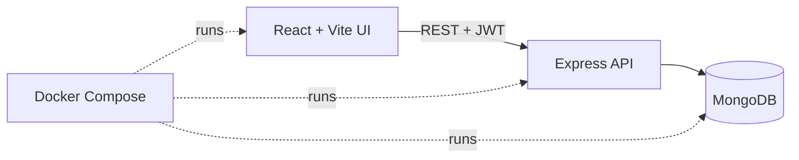

# PlantLog — Industrial Asset & Maintenance Logbook

**React · TypeScript · Node.js/Express · MongoDB · Docker Compose**

A full-stack industrial operations prototype that organizes asset records, maintenance activities and shift incidents into a single operator-facing workflow.


**Explore:** [Portfolio project](https://senanur-cetin.vercel.app/#projects) · [Asset registry](docs/assets.png) · [Maintenance log](docs/logs.png)

## Problem and approach

In many facilities, asset lists, shift handovers and maintenance histories live in separate spreadsheets or paper registers. PlantLog demonstrates a unified web workflow for tracking equipment and operational events, with a REST API backed by MongoDB.

## Features

- **Asset registry:** central equipment list and status-oriented views.
- **Maintenance and incident records:** structured operational logs for review and handover.
- **Authentication:** JWT-backed API authentication and role-oriented application flows.
- **Operator dashboard:** overview interface for operational status and recent activity.
- **Separated services:** React/Vite frontend, Express API and MongoDB database.

## Architecture



| Component | Implementation | Location |
|---|---|---|
| Web UI | React 18, TypeScript, Vite, Zustand, Tailwind | `frontend/` |
| API | Node.js, Express, TypeScript, Mongoose | `backend/` |
| Persistence | MongoDB 6 | Compose service `mongodb` |
| Deployment demo | Docker Compose / Nginx | `docker-compose.yml` |

## Getting started

### Option A — Docker Compose (local demo)

**Requirements:** Docker Engine or Docker Desktop with Compose, and an available port 8081, 5000 and 27017.

```bash
git clone https://github.com/senanurcetin/PlantLog-MERN.git
cd PlantLog-MERN

# Set a strong, unique local JWT secret before running the stack.
# Linux/macOS:
export JWT_SECRET="replace-with-a-long-random-secret"
docker compose up --build -d
```

On PowerShell, set `$env:JWT_SECRET="replace-with-a-long-random-secret"` instead.

- Web application: `http://localhost:8081`
- REST API: `http://localhost:5000/api`
- MongoDB: `localhost:27017` (local development only)

Stop the stack with `docker compose down`; add `-v` **only** if you intentionally want to delete the database volume.

### Option B — Run services locally

**Requirements:** Node.js 20+, npm, and a running local MongoDB instance.

```bash
cd backend
npm install
cp .env.example .env
# Edit .env and set MONGO_URI and a strong JWT_SECRET
npm run dev
```

Start the frontend in a separate terminal from the repository root:

```bash
cd frontend
npm install
cp .env.example .env
# VITE_API_URL defaults to http://localhost:5000/api
npm run dev
```

PowerShell users can replace `cp` with `Copy-Item`.

## Validation

```bash
cd backend && npm run build
cd ../frontend && npm run build
```

The repository exposes build scripts but does **not** currently provide a documented automated backend test suite. Do not interpret a successful build as end-to-end functional or security validation.

## Security and limitations

- **Development configuration only:** the supplied Compose file exposes MongoDB on the host and provides an insecure fallback JWT secret. Set `JWT_SECRET` explicitly, restrict the database port and remove defaults before any external deployment.
- **Prototype scope:** this repository is not a production CMMS, EAM or validated regulated-industry logbook.
- **Authentication hardening:** assess session storage, authorization boundaries, audit retention and password policies before handling real operational records.
- **Demo assets:** screenshots show project interfaces and are not evidence of live equipment integration.

## Repository map

- `backend/src/` — API, persistence and authentication
- `frontend/src/` — user interface and API client
- `docker-compose.yml` — local three-service orchestration
- `docs/` — product screenshots and examples

## License

[MIT](LICENSE)
