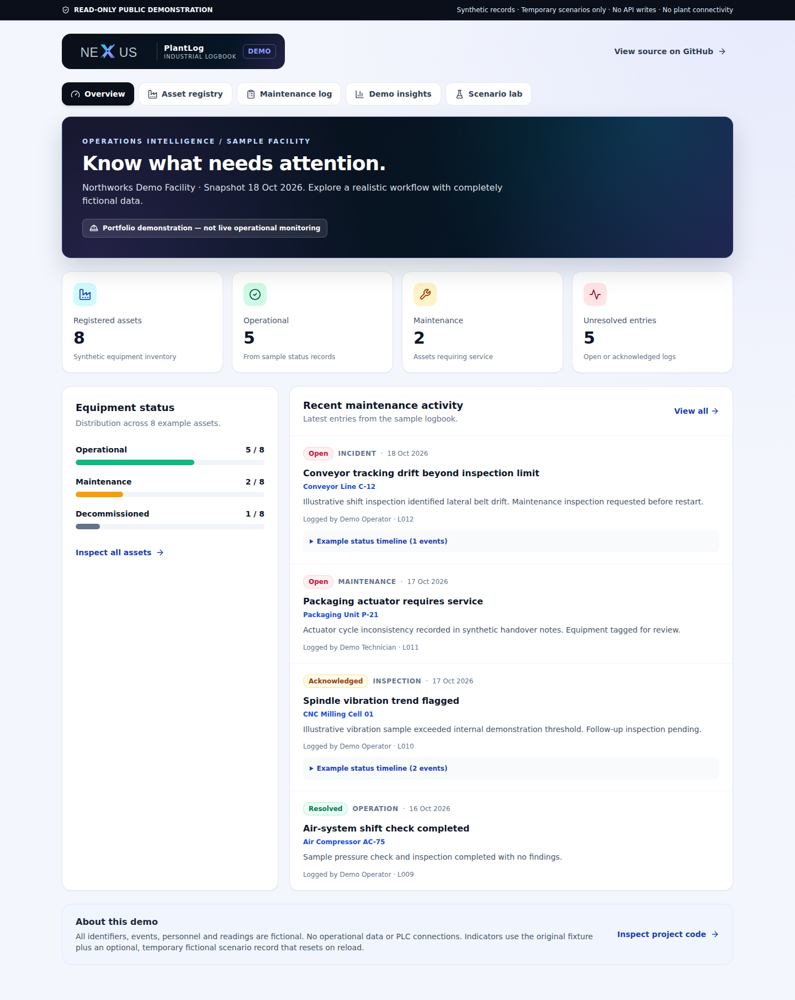
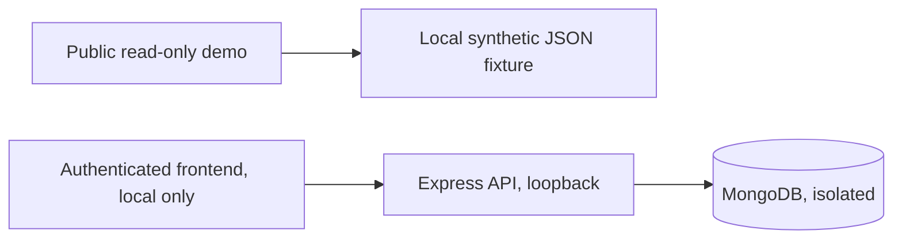

# PlantLog — NEXUS Industrial Asset & Maintenance Demonstrator

PlantLog is a React/TypeScript and Express/MongoDB equipment register and maintenance log, published as a read-only guest demo built on fictional data.


## Highlights

- **Equipment register and maintenance log:** assets, incidents, search, filters and per-asset history.
- **Insights:** workload and source-quality summaries with explicit exclusions; no downtime, failure probability, MTTR or MTBF figures are fabricated.
- **Six analysis labs:** controlled comparisons, eligibility sensitivity, status-history faults, UTC boundary cases, dual-axis evidence matrix and a document review workbench. Only the selected lab's module is loaded.
- **Scenario sandbox:** one disposable case moves through an in-memory lifecycle and can be reset, with no database writes or API requests.
- **Resilience and accessibility:** error isolation for deferred modules, explicit reload behavior, keyboard interaction, real-browser smoke checks and automated accessibility audits.

## Demo

[**Open live NEXUS demo**](https://plantlog-nexus-demo.vercel.app/demo) · [Documentation index](docs/README.md) · [Test and release verification](docs/release-verification.md) · [Security policy](SECURITY.md)



All **11 screenshots** are regenerated in isolated Chromium from the guest-only build ([gallery and SHA-256 manifest](docs/screenshots/README.md)):
[Equipment register](docs/screenshots/nexus-demo-assets.png) · [Maintenance records](docs/screenshots/nexus-demo-logs.png) · [Insights](docs/screenshots/nexus-demo-insights.png) · [UTC lab](docs/screenshots/nexus-lab-utc.png) · [Evidence matrix](docs/screenshots/nexus-lab-evidence-matrix.png) · [Review workbench](docs/screenshots/nexus-lab-review-workbench.png) · [Scenario desktop](docs/screenshots/nexus-scenario-lab-desktop.png) · [Mobile overview](docs/screenshots/nexus-demo-mobile.png)

## Quick start (guest demo)

**Prerequisite:** Node.js 20+ and npm.

```bash
git clone https://github.com/senanurcetin/PlantLog-MERN.git
cd PlantLog-MERN/frontend
npm ci
VITE_PUBLIC_DEMO_ONLY=true npm run dev
```

Open `http://localhost:5173/demo`. No MongoDB or account is needed. On Windows PowerShell set `$env:VITE_PUBLIC_DEMO_ONLY='true'` before `npm run dev`.

## Local full stack

`docker-compose.yml` binds all host ports to 127.0.0.1: frontend 8081, API 5000 and MongoDB 27017. Docker Engine and Compose must be running. Set a unique `JWT_SECRET` of at least 32 characters in your environment; do not commit credentials.

```bash
export JWT_SECRET="$(openssl rand -hex 32)"
docker compose up --build -d
docker compose ps
docker compose down
```

For manual development, copy `backend/.env.example` and `frontend/.env.example` to their local `.env` files, configure a local MongoDB and start each service with `npm run dev`.

## Architecture



| Component | Directory | Deployment |
|---|---|---|
| React/Vite/TypeScript client | `frontend/` | Guest demo hosted on Vercel |
| Express/TypeScript REST API | `backend/` | Local / CI only |
| MongoDB with schema and unique indexes | `backend/src/models/` | Local Docker or disposable CI database |
| Tests, release automation | `.github/workflows/`, `scripts/` | GitHub Actions |
| Screenshots and technical protocols | `docs/` | Repository documentation |

The backend provides role-aware local authentication, server-stamped lifecycle histories, validated CRUD, revision checks, audit diagnostics, liveness/readiness, and case-insensitive unique equipment serial numbers enforced by a MongoDB index. See [MongoDB integrity](docs/mongodb-integrity-contract.md) and [local API readiness](docs/preproduction-readiness.md).

## Testing

```bash
cd backend
npm ci
npm test
# Requires disposable localhost MongoDB:
npm run test:integration

cd ../frontend
npm ci
npm run test:demo
npm run test:registry
npm run lint
VITE_PUBLIC_DEMO_ONLY=true npm run test:perf
npm run evidence:verify
```

CI also runs real MongoDB integration tests, synthetic backup/restore, bounded local load, security/supply-chain checks, browser onboarding and accessibility audits. See [release verification](docs/release-verification.md) and [screenshot reproducibility](docs/screenshots/README.md).

## Repository layout

- `frontend/src/` — routes, components, fixture-driven guest demo and local authenticated views
- `frontend/tests/` — analysis, UI, browser and accessibility regressions
- `frontend/scripts/` — screenshot and analysis verification tooling
- `backend/src/` — routes, controllers, models, validation, auth and database checks
- `backend/tests/` and `backend/integration/` — policy tests and disposable MongoDB HTTP test
- `docs/` — engineering protocols; see [documentation index](docs/README.md)
- `docs/screenshots/` — browser captures, capture script and SHA-256 manifest
- `.github/workflows/` — CI and screenshot capture

## Limitations

- The public site is guest-only and read-only, backed by fictional fixtures. It never connects to the authenticated backend, a database or real assets.
- The authenticated API runs locally or in CI only and must not be exposed to the Internet without its own security design and review.
- PlantLog is not a certified CMMS/EAM, safety system or plant telemetry integration, and is not intended for real operator data. Industrial production acceptance gates G01–G10 are on hold.
- Passing CI or an automated WCAG check does not certify reliability or accessibility compliance.

## License

[MIT License](LICENSE).
