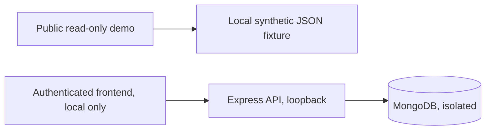

# PlantLog — NEXUS Industrial Asset & Maintenance Demonstrator

**Advanced, published, synthetic portfolio demo.** PlantLog is a React/TypeScript and Express/MongoDB engineering project. The **public website is guest-only, read-only and uses fictional fixtures**; it does not connect visitors to the authenticated backend, database, industrial assets or real maintenance operations. Industrial operational deployment remains outside this project's approved release scope.

[**Open live NEXUS demo**](https://plantlog-nexus-demo.vercel.app/demo) · [Documentation index](docs/README.md) · [Current test and release evidence](docs/release-verification.md) · [Security boundary](SECURITY.md)


## What the demo demonstrates

- **Equipment register and maintenance log:** fictional assets, incidents, search, filters and per-asset history.
- **Evidence-aware insights:** workload and source-quality summaries with explicit exclusions; no invented downtime, failure probabilities, MTTR or MTBF.
- **Six scientific laboratories:** controlled comparisons, eligibility sensitivity, status-history faults, UTC boundary cases, dual-axis evidence matrix and document review workbench. Only the selected experiment is mounted and its JavaScript module loaded.
- **Scenario sandbox:** one disposable fictional case can move through an in-memory lifecycle and be reset. No database writes or API requests occur.
- **Resilience and accessibility:** error isolation for deferred modules, explicit reload behavior, keyboard interaction, real-browser smoke checks and automated accessibility audits.

### Current screenshots

The **11 screenshots** are recreated in isolated Chromium from the same guest-only build configuration used for the public site. They are *application UI evidence*, not images of actual facilities or a claim of live-site browser capture. [Gallery and SHA-256 capture manifest](docs/screenshots/README.md).

[Equipment register](docs/screenshots/nexus-demo-assets.png) · [Maintenance records](docs/screenshots/nexus-demo-logs.png) · [Insights](docs/screenshots/nexus-demo-insights.png) · [UTC lab](docs/screenshots/nexus-lab-utc.png) · [Evidence matrix](docs/screenshots/nexus-lab-evidence-matrix.png) · [Review workbench](docs/screenshots/nexus-lab-review-workbench.png) · [Scenario desktop](docs/screenshots/nexus-scenario-lab-desktop.png) · [Mobile overview](docs/screenshots/nexus-demo-mobile.png)

## Architecture and deployment boundary



| Component | Directory | Deployment |
|---|---|---|
| React/Vite/TypeScript client | `frontend/` | Guest demo publicly hosted on Vercel |
| Express/TypeScript REST API | `backend/` | Locally bound / CI only |
| MongoDB with schema and unique indexes | `backend/src/models/` | Local Docker or disposable CI database |
| Tests, release automation | `.github/workflows/`, `scripts/` | GitHub Actions |
| Reproducible screenshots and technical protocols | `docs/` | Repository documentation |

The backend provides role-aware local authentication, server-stamped lifecycle histories, validated CRUD, revision checks, audit diagnostics, liveness/readiness, and strict case-insensitive unique equipment serial numbers at the MongoDB index level. **Its existence in source control does not make it a public backend service.** See [MongoDB integrity](docs/mongodb-integrity-contract.md) and [local API readiness](docs/preproduction-readiness.md).

## Run the guest demo locally

**Prerequisite:** Node.js 20+ and npm.

```bash
git clone https://github.com/senanurcetin/PlantLog-MERN.git
cd PlantLog-MERN/frontend
npm ci
VITE_PUBLIC_DEMO_ONLY=true npm run dev
```

Open `http://localhost:5173/demo`. This path does not need MongoDB or an account. On Windows PowerShell set `$env:VITE_PUBLIC_DEMO_ONLY='true'` before `npm run dev`.

## Run the local full stack (engineering use only)

`docker-compose.yml` binds **all host ports to 127.0.0.1**: frontend 8081, API 5000 and MongoDB 27017. Docker Engine and Compose must be running. Set a **unique JWT_SECRET of at least 32 characters** in the invoking environment; do not commit credentials.

```bash
export JWT_SECRET="$(openssl rand -hex 32)"
docker compose up --build -d
docker compose ps
docker compose down
```

For manual development, copy `backend/.env.example` and `frontend/.env.example` to their local `.env` files, configure local MongoDB and start each service with `npm run dev`. The authenticated API must **not** be exposed to the Internet without an independent security design and acceptance process.

## Reproducible verification

```bash
cd backend
npm ci
npm test
# Requires disposable localhost MongoDB:
npm run test:integration

cd ../frontend
npm ci
npm run test:demo
npm run test:registry
npm run lint
VITE_PUBLIC_DEMO_ONLY=true npm run test:perf
npm run evidence:verify
```

CI separately exercises actual MongoDB integrations, synthetic backup/restore, bounded local load, security/supply-chain checks, browser onboarding and accessibility. [Release evidence and limits](docs/release-verification.md) · [Screenshot reproducibility](docs/screenshots/README.md).

## Repository organization

- `frontend/src/` — routes, components, fixture-driven guest demo and local authenticated views
- `frontend/tests/` — scientific, UI, browser and accessibility regressions
- `frontend/scripts/` — screenshot and scientific verification tooling
- `backend/src/` — routes, controllers, models, validation, auth and database checks
- `backend/tests/` and `backend/integration/` — policy tests and disposable MongoDB HTTP test
- `docs/` — curated engineering protocols; see [documentation index](docs/README.md)
- `docs/screenshots/` — current browser images, capture script provenance and SHA-256 manifest
- `.github/workflows/` — CI and reproducible visual evidence

## Limitations and license

PlantLog is **not** a certified CMMS/EAM, safety system, plant telemetry integration, or production service for genuine operator data. All public records are invented. Passing CI or an automated WCAG check does not certify reliability or compliance. Industrial production acceptance gates G01–G10 remain HOLD.

[MIT License](LICENSE).
