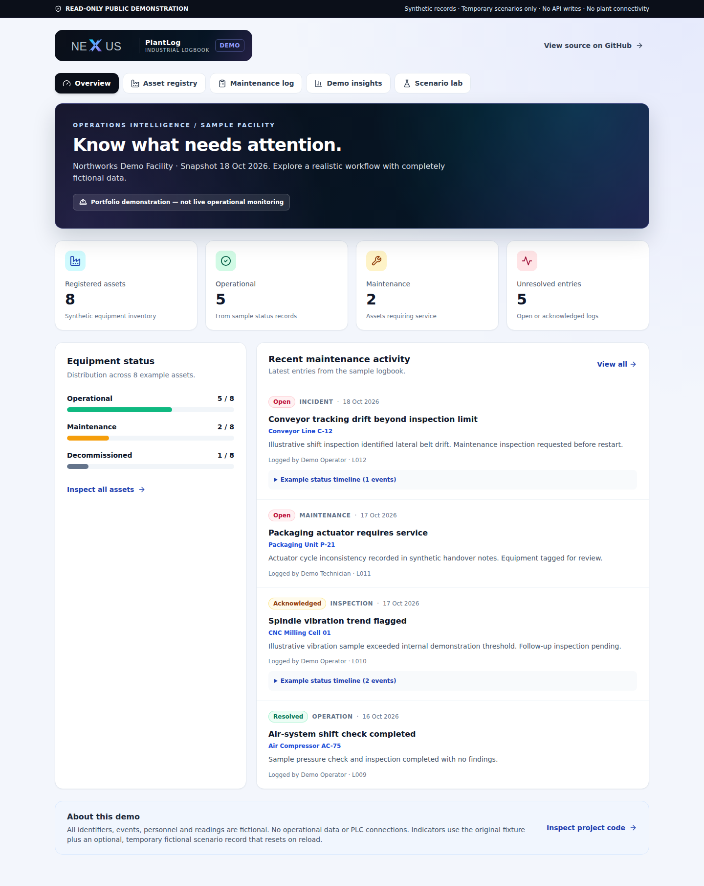

# Current synthetic NEXUS screenshot gallery

**Gallery generation is versioned and repeatable.**

These screenshots are produced by `frontend/scripts/capture-doc-screenshots.cjs` in **headless Chromium** against an isolated local Vite preview built with `VITE_PUBLIC_DEMO_ONLY=true`. This is the *same guest-only build mode* used for the hosted site, but **not** a screenshot of the external Vercel URL. The canonical image provenance, source revision, UTC capture date, selected laboratory, viewport and PNG SHA-256 are in [manifest.json](manifest.json).

The gallery contains only fictional equipment and maintenance records (8 fictional assets, 12 logs), with an optional in-memory SIM-001 example for the scenario views. No authentication token, customer data, database, plant access or API request is involved.

## Desktop (1440 × 900 viewport)



[Equipment register](nexus-demo-assets.png) · [Maintenance log](nexus-demo-logs.png) · [Demo insights](nexus-demo-insights.png) · [UTC boundary lab](nexus-lab-utc.png) · [Evidence matrix](nexus-lab-evidence-matrix.png) · [Review workbench](nexus-lab-review-workbench.png) · [Scenario in progress](nexus-scenario-lab-desktop.png)

## Mobile (390 × 844 viewport)

[Guest overview](nexus-demo-mobile.png) · [Insights](nexus-demo-insights-mobile.png) · [Scenario in progress](nexus-scenario-lab-mobile.png)

## Reproduce and verify

```bash
cd frontend
npm ci
VITE_PUBLIC_DEMO_ONLY=true npm run build
npm install --no-save --no-package-lock playwright@1.56.1
npx playwright install chromium
VITE_PUBLIC_DEMO_ONLY=true node scripts/capture-doc-screenshots.cjs
```

Capture validates loading, expected headings, panel selection, 12/12 eligible fixture records, 8 quality gates, no horizontal overflow, no API requests and no JavaScript page errors. The script writes PNG images plus a machine-readable manifest with each screenshot's checksum. CI captures on an isolated documentation branch and commits the refreshed artifacts; human review is still required before merging.

**Scope:** This is visual regression/documentation evidence, not manual accessibility certification, real-time machine telemetry or a production API screenshot.
